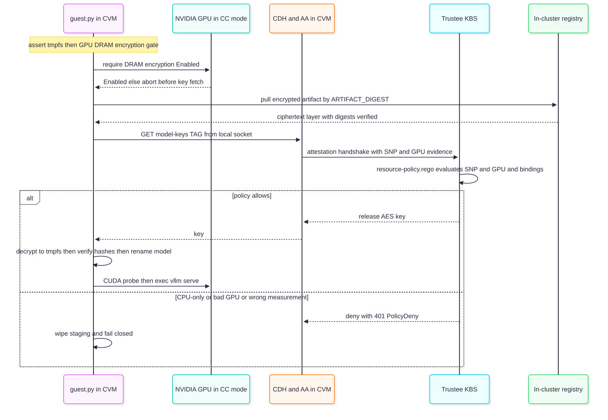

# Confidential inferencing (kata-cc + NVIDIA GPU CC)

This document describes how to extend the Private Coding Assistant (PCA) so that model serving runs inside hardware-isolated Confidential VMs (CVMs) using the `kata-cc-nvidia-gpu` runtime class, giving end-to-end private inferencing where model weights, prompts, activations and KV cache are protected from the cluster, hypervisor and infrastructure administrators.

The baseline it adapts is the Red Hat Confidential Containers (CoCo) validated pattern.

Intended Audience:
Regulated or IP-sensitive teams - finance, healthcare, public sector, or any
org with proprietary source and strict data-handling rules - that want the Dev Spaces coding
assistant but cannot accept that their source, prompts, and generated code pass in plaintext
through inference infrastructure they don't fully control. The same concern applies to the
model itself: a licensed or proprietary model whose weights must not be readable by whoever
operates the cluster. Today a platform or cloud/host administrator with node access could 
read the weights on the PVC and the prompts/KV cache in GPU and CPU memory. This
change removes that exposure: the developer's experience is unchanged (same IDE, same MaaS
endpoint), but serving runs inside an attested confidential VM so the infrastructure operator
— including a managed-service or cloud admin — cannot see the code, the prompts, or the model.
It is the enabler for offering PCA as a managed/shared service, or on hardware the data owner
does not administer, while still being able to attest that confidentiality holds.

This is opt-in: every piece will be gated behind `confidential.enabled` (§8),
so with the flag off PCA renders and behaves exactly as it does today (ordinary GPU
serving), and turning it off again returns to that baseline.

---

## 1. Goal and scope

Today PCA serves a model with vLLM under llm-d/KServe on an ordinary GPU node (`runtimeClassName` unset → `runc`; GPU exposed as `nvidia.com/gpu`). Plaintext weights sit on a PVC, and prompts/KV cache live in host-visible GPU and CPU memory. A cluster admin or anyone with node access can read them.

**Goal:** move the vLLM serving pod into a Kata Confidential VM backed by a CPU TEE
(AMD SEV-SNP or Intel TDX) with the NVIDIA GPU in **Confidential Computing (CC) mode**,
and release the model decryption key **only after composite CPU + GPU remote attestation**
succeeds. The result:

- Weights are distributed **encrypted** (AES-256-GCM) and decrypted only inside the CVM, in
  memory (tmpfs), after attestation.
- GPU DRAM is encrypted; the GPU proves its CC state via NVIDIA attestation.
- Prompts, completions, activations and KV cache stay inside the measured TEE boundary.
- Infrastructure admins see only ciphertext (model artifact, LUKS/tmpfs) and TLS ciphertext.

**In scope:** the serving data plane (vLLM) and the AI Gateway / MaaS data plane
co-located in the same confidential VM, plus the platform beneath them (OSC/Kata,
Trustee/KBS, GPU operator CC-mode, attestation policy, encrypted-model pipeline). Running the
gateway inside the CVM means client TLS terminates inside the TEE, so prompts and completions
never appear in plaintext outside the measured boundary — true end-to-end private inferencing
rather than weights-only protection (see §5.4, §7).

---

## 2. What the base implementation gives us

| Branch @ commit | What it contributes | How we use it |
|---|---|---|
| `codex/edge-rtx6k` @ `46739d16` | Bare-metal Kata CC on AMD SEV-SNP + NVIDIA Blackwell RTX PRO 6000; `kata-cc-nvidia-gpu` RuntimeClass via OSC `KataConfig`; GPU operator CC-mode ClusterPolicy; Trustee/KBS with SNP + NVIDIA verifiers; encrypted-model producer + attesting guest; CUDA/GPU readiness runbooks; pytest suites. | Platform foundation and runtime wiring. |
| `rhoai-confidential-qwen` @ `6c86a49a` / `383fcbda` | Same stack packaged to run the encrypted Qwen3 workload on a KServe-capable (OpenShift AI) cluster; optional `InferenceService` wrapper around the confidential pod; initdata binding of the protected model-key resource class. | The serving-side integration template. Generate **new** site keys, measurements and bindings |

The pod does not launch vLLM directly; it launches a Python guest orchestrator (`guest.py`) that attests, fetches the key from the Confidential Data Hub, decrypts into tmpfs, verifies, then `exec`s `vllm serve`. KServe is a thin predictor wrapper around the identical confidential pod spec.

---

## 3. How it maps onto PCA's chart steps

The integration threads through the existing step ordering rather than adding a parallel
stack. New or changed pieces per chart:

| Step / chart | Exists today | Add for confidential inferencing |
|---|---|---|
| 1 · `pca-operators` | RHOAI, NVIDIA GPU, DevSpaces, NFD, RHCL, cert-manager, LWS | **OpenShift Sandboxed Containers (OSC)** operator; **Trustee** operator; **External Secrets Operator (ESO)** (Trustee key/collateral delivery). GPU operator stays but its ClusterPolicy changes. |
| 2 · `pca-platform-config` | Namespaces, DSC/DSCI, NVIDIA `ClusterPolicy`, NFD instance, MaaS gateway/TLS | `KataConfig` CR + GPU RuntimeClass reconcile; **CC-mode** fields on `ClusterPolicy`; NFD `NodeFeatureRule` for SEV-SNP/TDX + GPU; **Trustee/KBS** CR + resource policy (`.rego`) + reference values; **CoCo initdata** ConfigMap; **Kyverno** policies that inject initdata into Kata pods. |
| 3 · `pca-ai-serving` | `LLMInferenceService` (vLLM), PVC, HardwareProfile, MaaS HTTPRoute | Confidential serving variant of the pod: `runtimeClassName: kata-cc-nvidia-gpu`, GPU as `nvidia.com/pgpu`, initdata mount/annotation, `guest.py` orchestrator, results sidecar; **AI Gateway / MaaS data plane co-located in the CVM** (TLS terminates in-TEE, loopback to vLLM — §5.4); **encrypted-model producer Job**; model-key **and gateway TLS key** released by KBS; **TLS-passthrough ingress** in front. |
| 4 · `pca-devspaces` | Per-dev workspaces + extension ConfigMaps | IDE targets the TLS-passthrough ingress hostname fronting the in-CVM gateway (same MaaS credential + model alias). Only the endpoint hostname changes. |
| 5 · `pca-benchmarks` | GuideLLM Job | Unchanged (runs against the serving Service). |



Step 3 runs the AI Gateway data plane and vLLM together in one confidential VM: the gateway
terminates client TLS inside the TEE and forwards to vLLM on loopback (see §5.4 and §7). KBS
releases both the gateway TLS material and the model key into that same measured VM.

---

## 4. Hardware and platform prerequisites

Confidential GPU inferencing path has been primarily tested on **bare-metal / on-prem** clusters.

| Requirement | Detail |
|---|---|
| CPU TEE | AMD **SEV-SNP** or Intel **TDX**, enabled in BIOS. |
| GPU | NVIDIA **CC-capable** GPU: Hopper (H100/H200) or Blackwell (B200, RTX PRO 6000 Blackwell). CC mode encrypts GPU DRAM and emits attestation reports. |
| OpenShift | 4.22+ & 5.0+ |
| OSC / Trustee | OSC 1.13+, Trustee 1.2+ (base lab versions). |
| GPU operator | 26.3.x with `ccManager` support. |
| IOMMU / BIOS | IOMMU on, interrupt remapping, ACS on bridges, each GPU in its own IOMMU group; host loads **no** NVIDIA driver (driver runs in the Kata guest image). |
| Attestation collateral | AMD VCEK certs (offline store) and/or Intel DCAP collateral firmware/GPU reference values. |

---

## 5. Component design

### 5.1 `pca-operators`

Add Subscriptions alongside the existing ones in
[`subscriptions.yaml`](../charts/pca-operators/templates/subscriptions.yaml), each gated by a
values flag (e.g. `operators.confidential.enabled`) so non-confidential deployments are
unaffected:

- `sandboxed-containers-operator` → ns `openshift-sandboxed-containers-operator`.
- `trustee-operator` → ns `trustee-operator-system`.
- `external-secrets-operator` (for Trustee key/collateral delivery; or substitute the key
  mechanism PCA prefers — see §5.3 open decision).

The NVIDIA GPU operator Subscription stays; only its `ClusterPolicy` changes.

### 5.2 `pca-platform-config`

**RuntimeClass.** Add a `KataConfig` (`kataconfiguration.openshift.io/v1`, name
`default-kata-config`) that builds the GPU-enabled Kata guest image (carrying the in-guest
NVIDIA driver). OSC generates the `kata-cc-nvidia-gpu` RuntimeClass. Port the
`ansible/reconcile-kataconfig-gpu.yaml` logic as a Helm hook/Job that forces re-reconcile
when GPU nodes are present but the RuntimeClass is missing.

**GPU CC mode.** Extend
[`nvidia-cluster-policy.yaml`](../charts/pca-platform-config/templates/nvidia-cluster-policy.yaml)
with the CC/sandbox fields:

```yaml
spec:
  ccManager:
    enabled: true
    defaultMode: "on"            # GPU Confidential Computing mode
  sandboxWorkloads:
    enabled: true
    defaultWorkload: vm-passthrough
  kataSandboxDevicePlugin:
    enabled: true                # exposes nvidia.com/pgpu
  vfioManager:
    enabled: true
  # in-guest driver → disable host-side components
  driver: { enabled: false }
  toolkit: { enabled: false }
  devicePlugin: { enabled: false }
```

Note this **conflicts** with the current `driver.enabled: true` / `toolkit.enabled: true`
defaults, so the confidential ClusterPolicy must be a distinct rendered variant selected by
the confidential flag, not an unconditional edit.

**Node selection.** Add an NFD `NodeFeatureRule` (from `charts/all/baremetal/templates/kata-nfd.yaml`)
to label SEV-SNP/TDX-capable GPU nodes; gate CVM scheduling on those labels.

**Trustee / KBS.** Deploy the KBS (`kbs-config.toml`: HTTPS, `coco_as_builtin`, RVPS
`LocalJson`, `admin DenyAll`) with the `snp_verifier` (offline VCEK) and `nvidia_verifier`
(`type = Remote`) enabled. Load the **resource-release policy** (`resource-policy.rego`) and
reference values. This is the load-bearing authorization gate (§6). Wire key/collateral
delivery via ESO→Vault, or the chosen alternative.

**initdata + injection.** Render the CoCo **initdata** TOML
(`ansible/initdata-default.toml.tpl`) into a ConfigMap: Attestation Agent + CDH pointing at
`https://kbs.<domain>`, image security policy URI, and the **Kata agent policy** that fails
closed (`ExecProcessRequest`/`ReadStreamRequest`/`WriteStreamRequest` default `false`; only
the attestation-status curls whitelisted). initdata is **measured** into attestation
evidence. Add the Kyverno `ClusterPolicy` that, on Pod CREATE with
`runtimeClassName ∈ {kata, kata-cc, kata-cc-nvidia-gpu}` and annotation
`coco.io/initdata-configmap`, injects
`io.katacontainers.config.hypervisor.cc_init_data`.

### 5.3 `pca-ai-serving`

The current [`llminferenceservice.yaml`](../charts/pca-ai-serving/templates/llminferenceservice.yaml)
runs vLLM directly. For the confidential variant (behind `confidential.enabled`), the pod
template must become the attesting-guest shape:

| Field | Current | Confidential |
|---|---|---|
| `runtimeClassName` | `runc` | `kata-cc-nvidia-gpu` |
| GPU resource | `nvidia.com/gpu` | `nvidia.com/pgpu` (passthrough into CVM) |
| Container command | `python3 -m vllm...` directly | `python3 /scripts/guest.py` → `exec vllm serve /private/model` |
| Model source | `hf://…` via storage-initializer → PVC | Encrypted OCI artifact pinned by `ARTIFACT_DIGEST`; decrypted to tmpfs |
| Plaintext weights | PVC `model-cache` | tmpfs `emptyDir{medium: Memory}` only; wiped on failure |
| Key material | none | fetched from CDH socket `http://127.0.0.1:8006/cdh/resource/default/model-keys/<tag>` |
| initdata | none | ConfigMap mounted at `/opt/confidential-containers/initdata` + annotation |
| Logs | pod stdout | httpd **results sidecar** on :8080 (agent policy blocks stdout) |
| GPU CC gate | none | `gpu_security.require_encrypted_dram()` before any key fetch |

**Encrypted-model producer.** Add a one-time Job (port `producer.py` + `producer-job.yaml`)
that runs **outside** the TEE in the trusted build/admin context: downloads the pinned model
revision from HF, verifies per-file size + hash, AES-256-GCM encrypts each file (per-file
nonce; AAD binds `{format, model, revision, key_resource, file}`), writes `bundle.json`, and
pushes a **non-executable** OCI data layer (ciphertext + public metadata only) to the
in-cluster registry. It prints the immutable manifest digest → that becomes
`inference.artifactDigest`. Because PCA already pins a model revision
(see [models-and-hardware.md](models-and-hardware.md)).

### 5.4 AI Gateway / MaaS data plane inside the CVM

Weights-only protection would still expose prompts and completions wherever TLS terminates
outside the CVM. To close that gap, the **AI Gateway / MaaS data plane runs in the same
confidential VM as vLLM** and is the TLS termination point.

Design:

- **TLS terminates inside the TEE.** External ingress is **TLS-passthrough** (OpenShift
  passthrough Route / Gateway); it forwards ciphertext and never holds the private key. The
  gateway inside the CVM presents the endpoint certificate and terminates the client TLS
  session.
- **Gateway TLS key via KBS.** The gateway private key is **released by Trustee/KBS into the
  CVM** after attestation (same mechanism as the model key — see §6), or generated inside the
  CVM. It is never an inference-cluster `Secret` readable by a host/cluster admin. Add a
  `default/gateway-tls/<name>` resource to the KBS resource policy with the same affirming requirements and measurement/initdata binding.
- **Loopback to vLLM.** The gateway forwards authorized requests to vLLM on `127.0.0.1` inside
  the CVM; vLLM has no independently reachable endpoint. The guest orchestrator starts the
  gateway and vLLM in the same pod/VM.
- **Auth, authorization and limits, fail-closed.** The gateway enforces the MaaS API-key /
  identity policy, model authorization and request/token limits, and strips client
  credentials before forwarding to vLLM. If an identity or policy dependency is unavailable it
  **fails closed** — no plaintext retry, no external-model fallback.
- **Measured configuration.** The gateway startup code, config, allowed routes/filters and the
  vLLM backend are bound into the **measured initdata** (§5.2) so an altered gateway config
  cannot obtain the TLS key or the model key. Copy executable config into private storage and
  verify before use; deny exec, policy replacement and host writes to private paths.
- **Observability without leakage.** Export only allowlisted operational fields; no
  prompt-bearing logs, traces or body capture leave the CVM. Preserve SSE streaming and
  cancellation end to end.

PCA already owns the MaaS front-door HTTPRoute and AuthPolicy
([maas-httproute.yaml](../charts/pca-ai-serving/templates/maas-httproute.yaml),
[maas-kuadrant.yaml](../charts/pca-ai-serving/templates/maas-kuadrant.yaml)); the change is to
repoint ingress at the passthrough route and move the enforcing data plane into the CVM rather
than terminating TLS at `maas-default-gateway`. Validate pinned RHOAI / gateway / policy-engine
/ confidential-runtime versions and that operator reconciliation preserves the in-CVM
placement and the KBS-delivered certificate.

### 5.5 `pca-devspaces`

The IDE reaches the model through the **TLS-passthrough ingress hostname** that fronts the
in-CVM gateway, using the same MaaS credential and model alias as today. Only the endpoint
hostname changes: point `pca-devspaces` URL helpers and the OpenCode/Continue/Cline/Roo
extension ConfigMaps at the passthrough route, keep certificate verification on, and disable
any direct-vLLM or non-confidential fallback endpoint.

---

## 6. Attestation and key-release flow



<!-- Diagram source: images/confidential-attestation-flow.mmd (mermaid). Regenerate the SVG with: npx -p @mermaid-js/mermaid-cli mmdc -i docs/images/confidential-attestation-flow.mmd -o docs/images/confidential-attestation-flow.svg -b white -->

For PCA, **generate new site-specific measurements, initdata and bindings**:

- Image acceptance is `insecureAcceptAnything` in the lab — attestation gates **key release**, not image/app identity. Add an image-signature / cosign gate.
- Trustee + Vault were co-located with workloads in the lab — For PCA, Trustee/KBS must be independently administered (separate cluster or strongly isolated namespace with no inference-admin access).

---

## 7. Trust boundary and request path

The target request-path trust boundary (TLS passthrough to a termination point inside the CVM, vLLM on loopback, GPU attested) is summarised below:

| Location | Visible there | Treatment |
|---|---|---|
| Dev Spaces / dev device | Source, prompts, responses, credentials | Trusted client |
| Ingress / network (TLS-passthrough) | TLS ciphertext, SNI/metadata | Pass through only; never terminates TLS, never holds the private key, no body processing |
| AI Gateway **inside the CVM** | Decrypted request/response, client credentials | TLS terminates here, inside the TEE (§5.4); measured gateway + policies; no prompt-bearing logs/traces; strip client creds before loopback; no external fallback |
| Confidential VM + GPU | Model, prompt, activations, KV cache | Measured software; SNP + GPU CC; vLLM on loopback; no export |
| Trustee / KBS | Attestation evidence, policy, keys (model + gateway TLS) | Independently administered; fail-closed |
| MaaS identity / quota services (outside CVM) | Identity, model entitlement, usage metadata | Authenticated; metadata only — no prompt or completion bodies |
| Registry / block storage | Encrypted artifact, LUKS/tmpfs ciphertext | Verify artifact identity + integrity |

> **Scoping:** because the gateway terminates TLS inside the CVM (§5.4), plaintext prompts and
> completions never exist outside the measured boundary within the inference domain — the path
> is **end-to-end private**, not weights-only. This depends on the full chain holding: client,
> TLS-passthrough ingress, the measured in-CVM gateway, CPU + GPU protections, and KBS release
> policy. A gateway that terminates TLS **outside** the CVM (e.g. at `maas-default-gateway`, or
> a re-encrypting Route) would reintroduce a plaintext point and does **not** meet this
> boundary.

---

## 8. Configuration surface (new values)

Proposed, all gated so default (non-confidential) renders are unchanged:

```yaml
# pca-operators/values.yaml
operators:
  confidential:
    enabled: false        # OSC + Trustee + ESO subscriptions

# pca-platform-config/values.yaml
confidential:
  enabled: false
  kata:
    runtimeClassName: kata-cc-nvidia-gpu
  gpu:
    ccMode: "on"          # ClusterPolicy ccManager.defaultMode
  trustee:
    kbsUrl: https://kbs.<domain>
    snp: { enabled: true }
    gpu: { enabled: true }   # nvidia_verifier (NRAS)
  initdata:
    configMapName: initdata

# pca-ai-serving/values.yaml
confidential:
  enabled: false
  runtimeClassName: kata-cc-nvidia-gpu
  gpuResource: nvidia.com/pgpu
  artifactDigest: ""       # from the producer job output
  keyResource: default/model-keys/<tag>
  memoryMiB: "65536"
  cpus: "8"
  producer:
    enabled: false
    registryRepository: pca/encrypted-<model>
  gateway:                 # AI Gateway / MaaS data plane inside the CVM (§5.4)
    enabled: false
    tlsKeyResource: default/gateway-tls/<name>   # released by KBS into the CVM
    passthroughIngress: true                     # TLS-passthrough Route/Gateway in front
    vllmLoopbackPort: 8000
```

---

## 9. Implementation phases

1. **Platform bring-up (no model).** OSC + Trustee + ESO operators; `KataConfig` →
   `kata-cc-nvidia-gpu`; GPU operator CC-mode ClusterPolicy; NFD rule; verify a CUDA
   `vectorAdd` CoCo smoke pod attests and runs on the GPU (`nvidia.com/pgpu`). Port the base
   lab's GPU-readiness checks.
2. **Attestation + key release.** Trustee KBS with SNP + NVIDIA verifiers; `resource-policy.rego`;
   reference values; CDH key fetch demo (`kbs-access-*`). Prove CPU-only and bad-GPU evidence
   are **denied**.
3. **Encrypted model pipeline.** Producer Job → encrypted OCI artifact for PCA's model;
   record digest.
4. **Confidential vLLM serving.** `guest.py` orchestrator pod under the KServe predictor
   wrapper; tmpfs decrypt; results sidecar. vLLM is reachable only on CVM loopback (expose a
   temporary Service for bring-up testing only, then remove it).
5. **AI Gateway inside the CVM (§5.4).** Co-locate the AI Gateway / MaaS data plane with vLLM
   in the CVM; bind its startup code, config and allowed routes into the **measured** initdata;
   deliver the gateway TLS key via KBS (`default/gateway-tls/<name>`, never a host-readable
   Secret); enforce MaaS auth, model authorization and request/token limits, fail-closed; front
   it with a **TLS-passthrough** ingress and repoint the IDE (§5.5). Validate pinned
   RHOAI / gateway / policy-engine / confidential-runtime versions, certificate delivery and
   controller reconciliation.
6. **Hardening.** Image-signature / cosign gate (replace `insecureAcceptAnything`); independent
   Trustee administration; new site-specific measurements/bindings; full negative-test pass
   across attestation, artifact integrity, gateway bypass and plaintext-boundary checks.

---

## 10. Testing and acceptance

Port the base lab's pytest suites (`tests/` on both branches:
`encrypted-gpu`, `encrypted-inference`, `model-key-policy`, `confidential-storage`). Minimum
gates:

| Test | Required result |
|---|---|
| GPU CC gate | Serving starts only when GPU DRAM encryption = Enabled; CC-off node refuses before key fetch. |
| CPU+GPU attestation | Valid SNP+GPU evidence releases the key; CPU-only, debug-enabled, bad/absent GPU evidence, and replayed/expired evidence all **deny**. |
| Measurement/initdata binding | A changed guest image, command, initdata **or gateway config** cannot obtain the model key or the gateway TLS key even with a valid hardware quote. |
| Artifact integrity | Wrong key, tampered ciphertext, wrong digest, or altered inventory prevents readiness; no partial model served; GCM rejects leave no plaintext. |
| TLS termination boundary | Only the in-CVM gateway holds the gateway TLS key; ingress is passthrough and never terminates TLS; a non-confidential or re-encrypting gateway fails client validation. |
| Gateway auth + bypass | Gateway enforces MaaS auth, model authorization and limits; missing/invalid/revoked credentials and unauthorized models are rejected; client creds never reach vLLM; direct access to vLLM loopback from outside the CVM fails. |
| Plaintext boundary | Host-visible storage/backups contain only ciphertext; plaintext weights exist only in CVM tmpfs and are wiped on failure; no prompt/completion bodies in logs, traces or metrics outside the CVM. |
| Fail-closed restart | A fresh CVM re-attests; KBS outage blocks new starts; no plaintext retry or external fallback; gateway restart preserves approved routes, auth, TLS delivery and limits. |